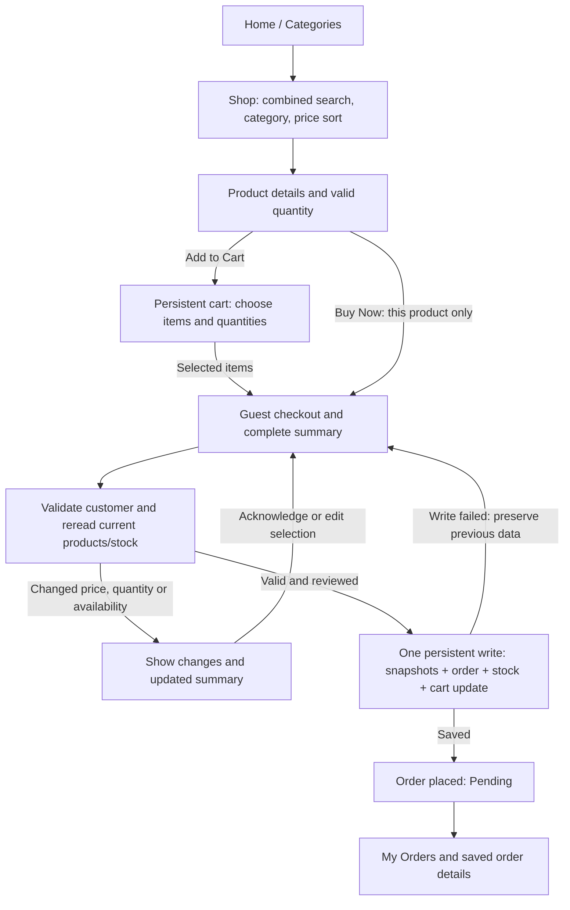
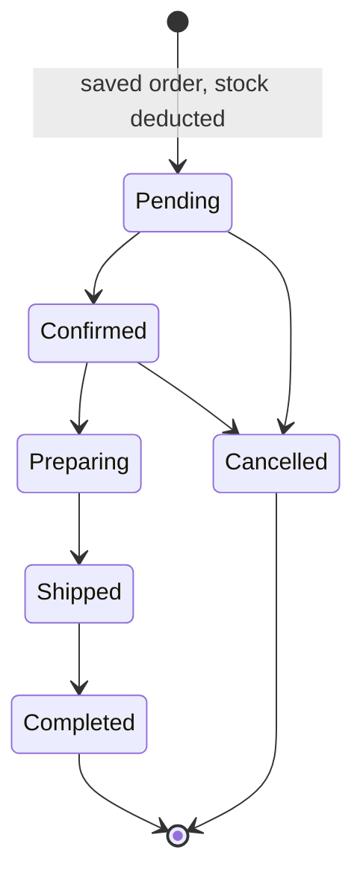
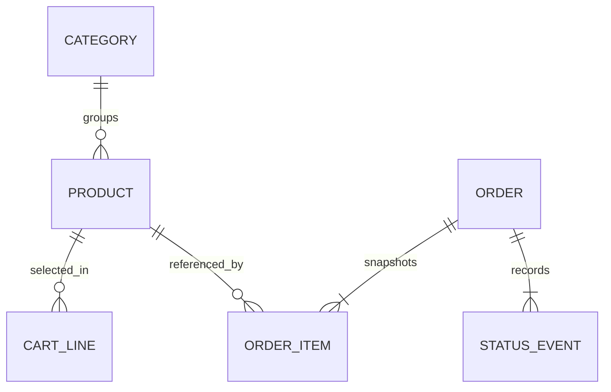

# System flow analysis and refinement

Reviewed all seven pages of the CubeTech assessment and the supplied OUD & AURA brief. The document's instructions define assessment requirements; its email submission details are not authorization to send anything.

## Required baseline from the PDF

Pages 1–2 require a working Home → Shop → Details → Cart journey with combined search/filter/sort, persistent merged quantities, correct PHP totals, and unavailable-product handling. Page 3 requires guest validation, an order summary, fresh availability/price checks, atomic saving, inventory deduction, snapshots, and Pending confirmation. Pages 3–5 define strict admin transitions, exactly-once cancellation stock restoration, catalog CRUD/reference rules, and shared persistent data. Page 6 defines ten acceptance checks. Page 7 requires documentation and evidence.

The PDF permits LocalStorage and simulated login. Guest checkout does not require customer accounts. PHP refers to Philippine pesos. The requested marketplace-style refinement is a shopping interaction preference; OUD & AURA keeps its own design and branding.

## Findings and resulting behavior

| Previous experience / risk | Refined behavior |
| --- | --- |
| A short added-to-bag message offered no direct next action | Added-to-cart feedback includes View cart; navigation consistently says Cart |
| Every cart item was checked out together | Product checkboxes, Select all, selected quantity and selected total; unpurchased lines remain |
| No direct product purchase action | Buy Now quotes just that product and quantity without changing the cart |
| Purchase stages were implicit | Cart/Product → Checkout → Order placed progress indicator |
| Leaving checkout to edit items discarded entered delivery details | Session-scoped checkout draft survives navigation/refresh and clears after a successful purchase |
| Quantity input committed on blur, and a related product reused its parent's quantity state | Valid quantities update immediately; invalid input blocks purchase/checkout; product navigation resets the selector |
| Price-change warnings did not have an explicit acknowledgement | Updated item summary and required review checkbox before retrying |
| No customer route to return to a purchase | My Orders lists saved orders, with status filters and details/history |
| Reopening an order always used a success message | Newly placed Pending orders show confirmation; subsequent visits use saved current status |
| An older admin edit could restore stock by writing its stale quantity | Expected-product comparison blocks stale edits and offers Reload latest product |
| Admin/customer progress could drift apart | Both use the same OrderJourney component and shared status-transition service |
| Very small admin text and one-card-wide mobile browsing | Larger table/action text, two-column mobile product cards, and contained table overflow |
| Saving each quantity digit temporarily disabled the input and lost keyboard focus | The input stays editable during queued writes; checkout waits for all saves; older results cannot replace the latest draft |
| Buy Now's Edit items link reset the selection to one bottle | The product edit URL carries the selected quantity and preserves it on refresh |
| Malformed optional image/display fields passed storage validation and crashed rendering | Shared validation rejects malformed display data before rendering, keeps it intact, and opens explicit recovery |

## Customer path

Selected checkout is an extension requested by the marketplace-like flow: when all cart items are selected, success clears the cart exactly as in the PDF baseline. When only some are selected, only purchased lines are removed. Buy Now never modifies the pre-existing cart; if that cart later exceeds the remaining stock, it must be adjusted before purchase.

## Order management

Both customer cancellation and admin management call the same transition function. A valid cancellation changes status and restores purchased quantities in one write. The status gate rejects a repeated cancellation after refresh. Completed sales count only Completed orders; cancelled and in-progress orders never contribute.

## Data model and ownership

`src/services/store.js` owns all domain mutations. UI pages call it and report success only after it resolves. `browserStore.js` supplies LocalStorage and a same-origin Web Lock. `useStore.jsx` updates the storefront/admin views after writes and browser storage events. Amounts stay in integer centavos until formatted for display. No separate customer records or stored sales totals can become stale.

Orders preserve purchased item names and unit prices. Products referenced by any order cannot be hard-deleted, and categories assigned to any product cannot be deleted. Customer summaries group trimmed, lowercase emails and take the latest submitted name/contact, including tied timestamps.

## Practical demo boundaries

The store/admin must use the same browser profile, hostname, and port. My Orders is a list of that browser's fictional orders, not secure personal account access. The three payment choices are simulated. This flow does not introduce payment collection, shipping fees, or a marketplace backend.
